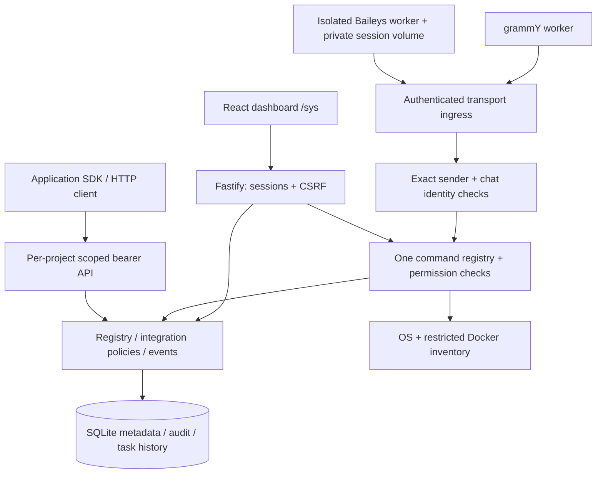

# Architecture

OCC 0.1 is a modular monolith, optimized for a single administrator and a small
ARM64 Linux host. Node 24's bundled SQLite avoids a native database addon or a
separate database service. The React UI adds no runtime service: Fastify serves
its built assets below a configurable prefix.

## Boundaries

`createApp` assembles services and supports Fastify injection for tests without
network sockets. There is one core backend. Messaging workers perform transport
translation only; the core resolves identities, parses arguments, authorizes and
executes commands. Platform-specific text delivery does not introduce another
implementation of any command.

Dashboard session users and messaging identities resolve to the same internal
user ID. A user has explicit command permissions. A platform identity is an exact
`(platform, sender ID)` association; group authorization is a separate table.
Sensitive commands are unavailable in groups even to an administrator.

Each accepted command creates a task record and a content-free audit record.
Arguments, replies and conversation bodies are not retained. Failed recognized
commands receive structured errors; unknown/ordinary messaging input is ignored.
SQLite `user_version` migrations are transactionally applied on startup. WAL,
foreign keys, busy timeout and prepared statements are enabled. Retention cleanup
runs at startup and once a minute; operational tables are capped at 10,000 rows
each as well as time-limited. Users, projects and settings survive cleanup.

## Integrations

An administrator approves a manifest and provisions a project-bound token. The
application can confirm registration, push its health, publish declared
namespaced metadata events, poll its own subscriptions and invoke explicitly
approved read-only operations. Declared operations do not become executable
merely by appearing in a manifest. Phase 1 only supports cached status/health
reads; no manifest URL, filesystem path or shell string is executed.

The event bus is in-process; accepted project events have SQLite-backed
idempotency and bounded retention. No broker, outbound webhook queue, cross-project
subscriptions or background delivery worker exists. Future n8n support must use
an explicit integration policy and signed, replay-protected outbound delivery.

## Monitoring

Monitoring has three explicit scopes. `host` is unavailable until an authenticated
isolated collector supplies fresh host-procfs/selected-filesystem observations.
`container` reports cgroup v2 memory current/max and CPU quota/usage for OCC's own
cgroup, with null limits when unlimited. `process` is OCC's own uptime/RSS. Existing
root OS fields remain for API compatibility and are labeled runtime OS view, not
confirmed host or container totals. No SQLite schema change is required.

The host collector mounts only individual stat/meminfo/uptime/loadavg/netdev files
and an empty selected filesystem directory, all read-only. It exposes only
`GET /metrics` with a private bearer credential, a bounded schema and timestamp.
Core rejects stale (>30s), future or invalid collector data instead of reusing it
as fresh. The core has no host mounts. The dashboard prioritizes a fresh host
collector, then cgroup data; it never substitutes OS totals as confirmed host
memory. Disk scope and process RSS/uptime are separately visible. Five-second
sampling and visibility-aware 15/30/60-second polling keep overhead small; requests
have deadlines/cancellation and stale observations are visibly labeled.

Docker defaults to disabled, with optional visibly labeled mock fixtures for
development. The opt-in monitor sidecar has exactly one upstream daemon operation:
`GET /containers/json?all=true`. It returns a selected inventory with Compose labels
and health status. Standalone containers have no Compose project. The core has no
Docker socket, and never assumes paths, names, ports or shared Compose ownership.
Discovery does not automatically register or alter applications. An administrator
can manually register resources whether or not discovery works.

## Runtime and deployment

Only core is necessary for mock development. Live Telegram and WhatsApp workers
are opt-in separate processes, with distinct ingress secrets. The WhatsApp session
volume is not mounted in core, the dashboard, Docker monitor or future AI tools.
Its worker disables history synchronization, does not archive conversations and
sends only commands recognized by the core-provided registry catalog. A single
supervisor class bounds retries, closes retired connections/listeners, and stops
automatic recovery on authentication/session/replacement failures. WhatsApp uses
an exclusive session lock and a one-request explicit pairing gate. Transport status uses ephemeral classified
heartbeats; after 45 seconds without one, workers are unobserved. Health files
contain status metadata only. Terminal auth states remain observable without
automatically restarting or pairing again.

Compose binds core to host loopback on a configurable unused port. The control
network is internal. Two separate collector-only networks each attach only core
and their respective collector. Messaging workers attach only gateway and egress;
future AI/integration processes must not attach to either collector network. Existing Kuma
and TelegramDL installations are never imported into OCC's Compose project.

Future AI adapters may call the structured router through an actor obtained from
the identity service. A model output cannot construct its own trusted actor.
See [ROADMAP.md](ROADMAP.md) for verification and authorization requirements before
any future write-capable execution service is added.
